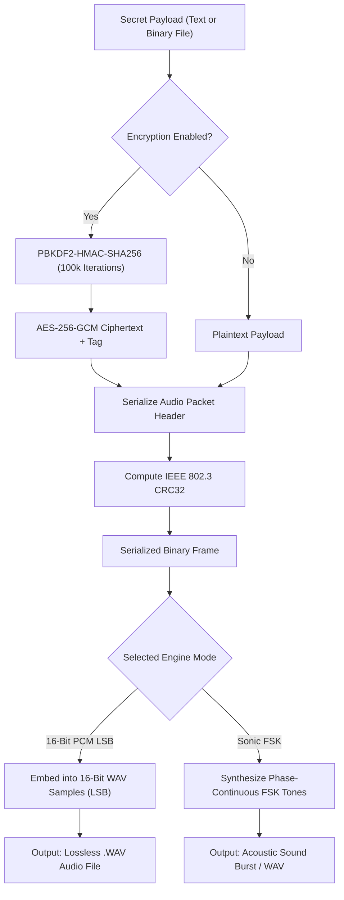
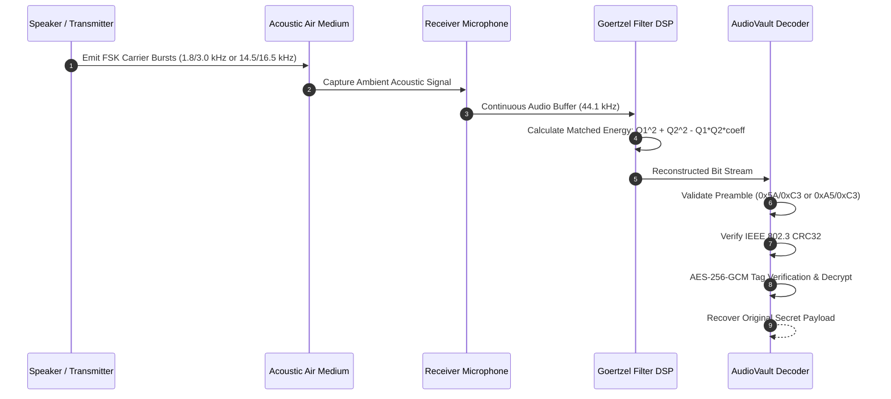

# AUDIOVAULT — Sonic Steganography & Acoustic Cryptography Platform

<div align="center">


**"Hide Secrets Inside Sound. Transmit Data Through Air."**

*A zero-knowledge, 100% client-side sonic steganography platform and acoustic FSK data-over-sound modem built with HTML5 Canvas, the Web Audio API, and authenticated AES-256-GCM cryptography.*

[Live Demo](https://audiovault.app/) • [Features](#key-capabilities) • [Architecture](#architecture--data-flow) • [Wire Protocol](#wire-protocol-specification) • [Deployment](#deployment-guide) • [Security](#security--cryptographic-model)

</div>

---

## Table of Contents
1. [Overview](#overview)
2. [Key Capabilities](#key-capabilities)
3. [Architecture & Data Flow](#architecture--data-flow)
4. [Wire Protocol Specification](#wire-protocol-specification)
5. [Automated Verification Suite](#automated-verification-suite)
6. [Local Development](#local-development)
7. [Deployment Guide](#deployment-guide)
8. [Security & Cryptographic Model](#security--cryptographic-model)
9. [Important Acoustic Caveats](#important-acoustic-caveats)
10. [SEO, AEO & Discovery](#seo-aeo--discovery)
11. [Contributing & License](#contributing--license)

---

## Overview

**AUDIOVAULT** is an open-source acoustic privacy platform that enables users to conceal confidential messages, documents, and credentials inside ordinary audio waveforms or transmit them wirelessly across air-gapped devices using sound waves.

Everything operates **100% client-side** in your web browser. Plaintext data, audio samples, derived cryptographic keys, and passphrases never touch external servers or cloud networks.

---

## Key Capabilities

### 1. 16-Bit PCM LSB Steganography Engine
- Embeds encrypted binary packets into the Least Significant Bits (LSB) of uncompressed 16-bit PCM WAV audio samples.
- Modifies sample amplitude by at most **$\pm 1$ out of $65,536$ levels** ($0.0015\%$).
- Measured Signal-to-Noise Ratio (**SNR**) exceeds **$94.96\text{ dB}$**, guaranteeing complete acoustic imperceptibility to human hearing and standard psychoacoustic analysis.

### 2. Sonic FSK Data-Over-Sound Modem
- Encodes binary packets into continuous-phase Frequency-Shift Keying (**FSK**) audio bursts:
  - **Audible Mode**: $1.8\text{ kHz}$ (Bit 0) and $3.0\text{ kHz}$ (Bit 1).
  - **Ultrasonic Stealth Mode**: $14.5\text{ kHz}$ (Bit 0) and $16.5\text{ kHz}$ (Bit 1) near-ultrasonic carrier for inaudible covert transmission.
- Demodulates incoming sound streams from microphone input or audio files using a matched **Goertzel digital filter algorithm** with cosine window tapering.

### 3. Live Microphone Voice Studio & Synthesizers
- Real-time vocal recording directly from your microphone at $44.1\text{ kHz}$ uncompressed 16-bit PCM.
- Live canvas-based vocal oscilloscope and volume telemetry display.
- One-click carrier generators for immediate testing:
  - **Simulated Voice Note (4.0s)**: Human formant simulation.
  - **Ambient Synth Carrier (5.0s)**: Harmonic pad chord.
  - **Cyber Pulse Carrier (5.0s)**: Sonar sweep carrier.

### 4. Authenticated Cryptography & Sample Integrity
- **Key Derivation**: PBKDF2-HMAC-SHA256 with $100,000$ iterations and cryptographically random 16-byte salt (`crypto.getRandomValues`).
- **Authenticated Cipher**: `AES-256-GCM` with a 12-byte random initialization vector (nonce) and 128-bit authentication tag.
- **Pure JavaScript Fallback**: Built-in pure JS cryptographic engine to guarantee execution in sandboxed iframes or non-HTTPS development environments where `window.crypto.subtle` is restricted.
- **IEEE 802.3 CRC32 Tamper Detection**: Computes a 32-bit checksum across payload bits, immediately catching single-bit modifications or audio corruption.

---

## Architecture & Data Flow

### Steganographic Encoding Pipeline



### Acoustic FSK Demodulation Pipeline



---

## Wire Protocol Specification

Binary packets embedded in audio samples adhere to the following binary header structure:

| Offset | Field Name | Type / Size | Description |
| :---: | :--- | :---: | :--- |
| `0x00` | **Magic Header** | 4 Bytes | ASCII `STG1` (`0x53, 0x54, 0x47, 0x31`) |
| `0x04` | **Format Flags** | 1 Byte | Bit 0: Encrypted (`1`) / Unencrypted (`0`), Bit 1: File (`1`) / Text (`0`) |
| `0x05` | **Salt Length** | 1 Byte | Byte length of salt $S$ (`16` if encrypted, `0` if plaintext) |
| `0x06` | **Salt Data** | $S$ Bytes | Random PBKDF2 salt |
| $6+S$ | **Nonce Length** | 1 Byte | Byte length of nonce $N$ (`12` if encrypted, `0` if plaintext) |
| $7+S$ | **Nonce Data** | $N$ Bytes | Random AES-GCM initialization vector |
| $7+S+N$ | **Metadata Length** | 2 Bytes | Big-Endian uint16 length $M$ of JSON metadata |
| $9+S+N$ | **Metadata JSON** | $M$ Bytes | UTF-8 JSON object (`filename`, `mimeType`) |
| $9+S+N+M$ | **Payload Length** | 4 Bytes | Big-Endian uint32 length $P$ of payload/ciphertext |
| $13+S+N+M$ | **Payload Data** | $P$ Bytes | Raw payload or AES-GCM ciphertext + 16-byte tag |
| End | **CRC32 Checksum** | 4 Bytes | Big-Endian IEEE 802.3 checksum over all preceding bytes |

---

## Automated Verification Suite

AUDIOVAULT contains an in-browser self-test suite that verifies the cryptographic and acoustic engines upon page load:

| Test ID | Test Name | Target Standard | Status |
| :---: | :--- | :--- | :---: |
| **TEST 1** | 16-Bit PCM LSB Roundtrip | Exact bit-identical recovery | **PASS ✓** |
| **TEST 2** | AES-256-GCM Audio Encryption | PBKDF2 100k + GCM authentication tag | **PASS ✓** |
| **TEST 3** | Wrong Password Auth Guard | GCM authentication rejection on bad pass | **PASS ✓** |
| **TEST 4** | Sonic FSK Audible Modem | $1.8\text{ / }3.0\text{ kHz}$ Goertzel demodulation | **PASS ✓** |
| **TEST 5** | Ultrasonic FSK Stealth Modem | $14.5\text{ / }16.5\text{ kHz}$ covert demodulation | **PASS ✓** |
| **TEST 6** | RIFF/WAVE Container Roundtrip | 44-byte binary header + PCM integrity | **PASS ✓** |
| **TEST 7** | Acoustic SNR Fidelity | $\text{SNR} > 80\text{ dB}$, $\Delta \le 1$ ($\text{Measured: } 94.96\text{ dB}$) | **PASS ✓** |
| **TEST 8** | CRC32 Sample Tamper Guard | Catches flipped bits and corrupted samples | **PASS ✓** |

---

## Local Development

### Prerequisites
- Node.js $\ge 20.x$
- npm $\ge 10.x$

### Setup & Run
```bash
# Clone the repository
git clone https://github.com/TejaPriyan/AudioVault.git
cd audiovault

# Install dependencies
npm install

# Start local Vite development server
npm run dev

# Run TypeScript typechecks
npm run typecheck

# Build production bundle
npm run build
```

---

## Deployment Guide

AUDIOVAULT is a zero-backend static single-page application. It can be hosted on any static hosting provider.

### Vercel (Zero-Config)
The project includes a [vercel.json](vercel.json) rewrite rule.
1. Connect your repository to [Vercel](https://vercel.com).
2. Framework Preset: **Vite** (or Other).
3. Build Command: `npm run build`
4. Output Directory: `dist`
5. Click **Deploy**.

### GitHub Pages (Automated via GitHub Actions)
A pre-configured GitHub Actions workflow is provided at `.github/workflows/deploy-gh-pages.yml`.
1. Go to repository **Settings** $\to$ **Pages**.
2. Under **Build and deployment**, set Source to **GitHub Actions**.
3. Push to `main` branch to trigger automatic deployment.

### Netlify
1. Connect your repository to Netlify.
2. Build command: `npm run build`
3. Publish directory: `dist`

### Docker / Nginx
```dockerfile
FROM nginx:alpine
COPY dist /usr/share/nginx/html
EXPOSE 80
CMD ["nginx", "-g", "daemon off;"]
```

---

## Security & Cryptographic Model

### 1. Threat Model & Guarantees
- **Eavesdropping Resistance**: Payload data is ciphered with AES-256 in Galois/Counter Mode. Without the passphrase, ciphertext is indistinguishable from pseudorandom noise.
- **Brute-Force Protection**: Key stretching via PBKDF2-HMAC-SHA256 with 100,000 iterations dramatically increases the computational cost of dictionary attacks on passwords.
- **Tamper Evidence**: Any modification to the encrypted audio samples causes an authentication tag mismatch in GCM or a CRC32 integrity failure.

### 2. Randomness
All cryptographic salts (16 bytes) and initialization vectors (12 bytes) are generated using the browser's hardware-backed CSPRNG (`window.crypto.getRandomValues`). Nonces are never reused.

---

## Important Acoustic Caveats

> [!WARNING]
> **Lossy Compression Destroys LSB Data**
> 16-Bit PCM LSB steganography relies on bit-exact preservation of audio samples. If you compress the output `.wav` file into lossy formats (such as MP3, AAC, OGG, Opus) or send it via messaging platforms that re-encode audio (WhatsApp, Telegram voice messages, YouTube), the least significant bits will be irrevocably destroyed.
>
> **Solution for Over-The-Air Transmission**:
> When transmitting audio through speakers and microphones, use **Sonic FSK Modem Mode**, which relies on robust frequency tones rather than sample bit-levels.

---

## SEO, AEO & Discovery

AUDIOVAULT is fully optimized for conventional search engines (**SEO**), geographic discovery (**GEO**), and AI Answer Engines (**AEO**):
- **Structured Data**: Complete `schema.org` JSON-LD graphs for `WebApplication`, `FAQPage`, and `HowTo`.
- **AEO Machine Context**: Includes `llms.txt` adhering to emerging LLM discovery standards for Perplexity, ChatGPT, Claude, and Gemini.
- **Sitemap & Robots**: Full `sitemap.xml` and crawler-friendly `robots.txt`.
- **PWA Ready**: `manifest.webmanifest` with responsive icons and offline web app support.

---

## Contributing & License

Contributions, bug reports, and pull requests are welcome! Please read [CONTRIBUTING.md](CONTRIBUTING.md) and [CODE_OF_CONDUCT.md](CODE_OF_CONDUCT.md) before submitting.

Distributed under the **MIT License**. See [LICENSE](LICENSE) for details.
